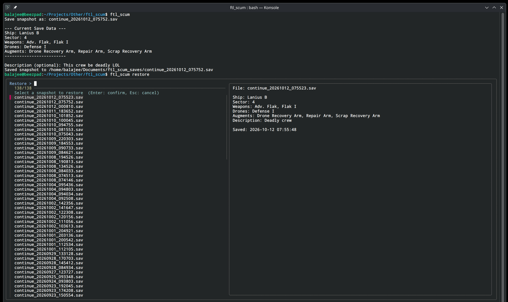

# FTL Scum

If you are going to cheat on a decade old single player game, might as well do it with style :)

## Overview
A command-line save-scumming utility for *FTL: Faster Than Light*. 

`ftl_scum` allows you to save snapshots of your current FTL game state, automatically parsing your `continue.sav` to generate human-readable metadata containing your equipped weapons, drones, augmentations, ship class, and sector. You can easily browse and restore your saved snapshots using an interactive `fzf` menu.

## Features
- **Auto-Parsing**: Reads FTL's binary save format (v1.6.1+) to extract your currently equipped loadout (Weapons, Drones, Augments).
- **Human Readable**: Translates internal IDs (like `LASER_CHAINGUN`) into friendly names (like `Chain Laser`).
- **Interactive Restore**: Browse your saves visually with a preview pane powered by `fzf`.
- **Single File**: The entire script, including the Python binary parser, is bundled into a single portable bash executable.

## Requirements
- `bash`, `python3`
- `fzf`, `findutils`, `coreutils`, `sed`

## Usage
- `./ftl_scum save` - Save a snapshot of your current game. You will be prompted to add an optional description.
- `./ftl_scum restore` - Open the fuzzy-finder to browse your snapshots and restore one over your active game.
